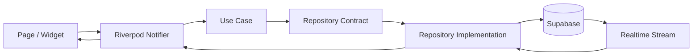
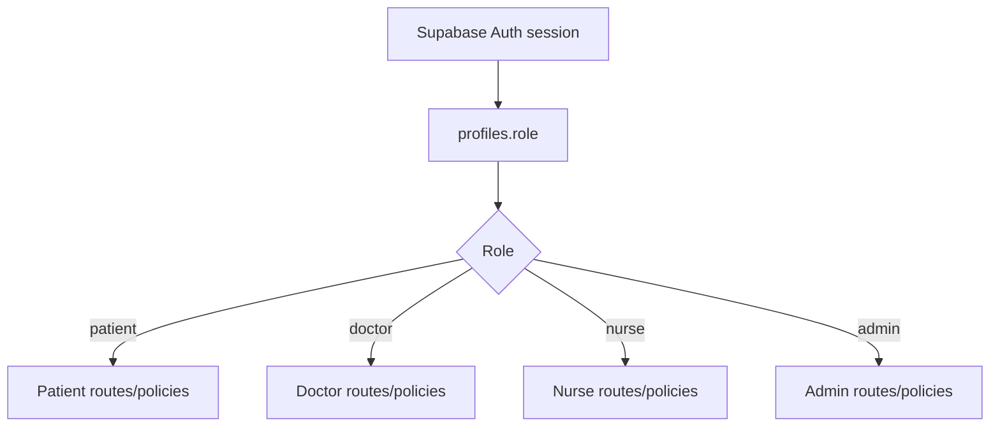

# Tahap 2 - Arsitektur Aplikasi

Status M01: kode memakai Riverpod, repository memori untuk janji dan rekam medis, konfigurasi offline, serta layanan PIN/secure storage. [ADR sinkronisasi](adr/001-repository-pattern.md) menjelaskan integrasinya. Struktur domain/data, Supabase, dan RBAC di bawah merupakan target tahap berikutnya.

## Keputusan arsitektur

Flutter menggunakan **feature-first Clean Architecture**:

```text
Presentation (Page, Widget, Riverpod Notifier)
        -> Domain (Entity, Repository contract, Use case)
        -> Data (Repository implementation, DTO, Supabase data source)
        -> External (Supabase Auth/Database/Realtime/Storage, notifications)
```

Presentation tidak boleh mengakses Supabase secara langsung. Domain tidak
bergantung pada Flutter atau SDK eksternal. Data menerjemahkan DTO/database
row menjadi entity domain dan memetakan error ke `Failure` yang konsisten.

## Alur request



## Alur RBAC



UI guard hanya meningkatkan UX. Sumber keamanan utama adalah RLS dan policy
database yang memeriksa `auth.uid()` serta role yang tersimpan secara aman.

## Struktur folder target

```text
lib/
├── config/                 # environment, theme, feature flags
├── core/                   # errors, result, network, secure storage, crypto
├── routes/                 # route names, guards, navigation
├── shared/                 # reusable widgets, extensions, validators
├── features/
│   ├── auth/
│   ├── appointment/
│   ├── medical_record/
│   ├── reminder/
│   ├── consultation/
│   ├── profile/
│   ├── admin/
│   ├── doctor/
│   ├── nurse/
│   └── home/
│       ├── data/
│       ├── domain/
│       └── presentation/
└── main.dart
```

Setiap fitur mengikuti pola:

```text
feature/
├── data/
│   ├── datasources/
│   ├── models/
│   └── repositories/
├── domain/
│   ├── entities/
│   ├── repositories/
│   └── usecases/
└── presentation/
    ├── controllers/
    ├── pages/
    └── widgets/
```

## Keputusan yang ditunda ke tahap berikutnya

- Konfigurasi URL/key Supabase tidak ditaruh di source code dan akan
  menggunakan environment build.
- Skema PostgreSQL, RLS, dan fungsi nomor antrean dibuat setelah kontrak domain
  disepakati pada tahap database.
- Dependensi notifikasi, QR, secure storage, dan AES ditambahkan bersama
  implementasi fitur agar konfigurasi native dapat diuji end-to-end.
